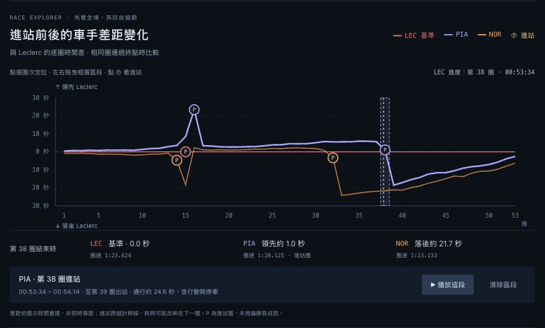
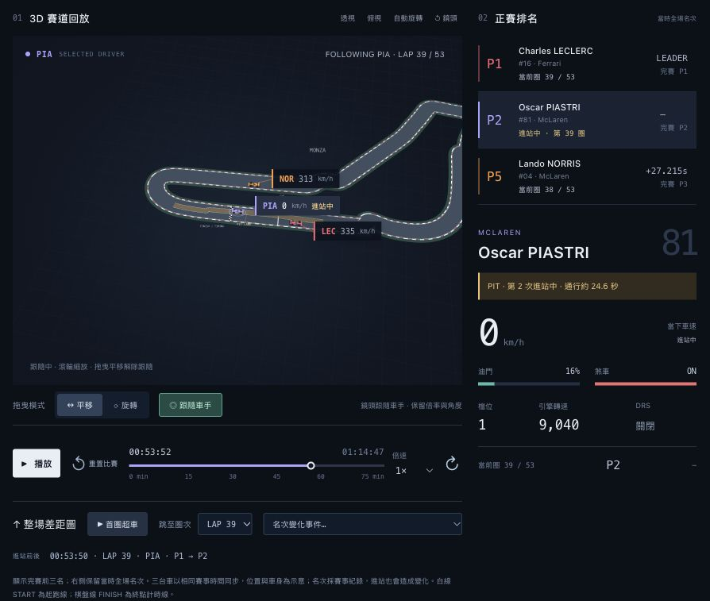
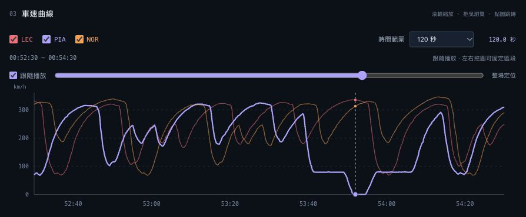

# F1 正賽動態視覺化

進站前後的車手差距變化

資料分析與視覺化應用 HW2　｜　415085047 嚴庭亞

更新日期 2026 年 10 月 30 日　｜　賽事日期 2024 年 9 月 1 日

我以 2024 年 Monza 正賽完賽前三名為比較對象，使用整場差距圖呈現進站前後的變化，並連動 3D 賽道回放與車速曲線。讀者可以先找出曲線轉折，再選取圈段觀看車輛動態，不必從頭播放整場比賽。

[GitHub 專案](https://github.com/victorien1963/1151VIS-HW2-415085047-YEN-TING-YA)

[互動網站](https://victorien1963.github.io/1151VIS-HW2-415085047-YEN-TING-YA/)

YouTube 互動影片：

圖 1　整場差距圖與進站標記　已選取 Piastri 第 38 圈進站片段

本文件介紹新增整場差距圖、區段回放與維修區呈現的版本，透過 GitHub Pages 提供免登入使用。截圖擷取自本機預覽，YouTube 影片連結保留空白。

## 資料整理與製作流程

### 選定賽事與比較對象

使用 OpenF1 的 2024 Monza 正賽資料，session_key 為 9590。依 FIA 最終成績選取 Charles Leclerc（16）、Oscar Piastri（81）及 Lando Norris（4），三人皆完成 53 圈。賽道單圈長度為 5.793 公里；選樣依據是完賽前三名，不代表三人全程都位於前三名。

Leclerc 為冠軍，用時 1:14:40.727；Piastri 落後 2.664 秒，Norris 落後 6.153 秒。圖表固定以粉紅、紫、橘色表示三位車手，方便跨區塊辨識，也能區分同屬 McLaren 的兩人。

### 整理資料並對齊賽事時間

下載位置、車速、油門、煞車、檔位、轉速與 DRS，合併圈次、全場名次、差距、進站及賽會紀錄。以 SESSION STARTED 的 2024-09-01T13:03:34.412Z 作共同 0 秒，即 Monza 15:03:34、台灣 21:03:34。三台車使用同一時鐘，保留當時的先後關係。

位置與連續遙測整理為每 0.25 秒一筆，離散狀態採最近取樣。資料處理檢查缺口，避免跨越大段缺測。回放面板採該時刻已知的名次、圈次及差距；上方整場圖則提供完整歷史資料供探索。

### 計算逐圈差距並連動回放

先用每圈起始時間加該圈圈速，重建通過終點的時刻，再減去 Leclerc 同圈過線時刻。差值為正代表落後，為負代表領先；圖上以零線區分上下，缺值不補成零。這是同圈完成時的比較，與右側距當時全場領先者的差距不同。

D3.js 使用線性比例尺、折線與資料綁定繪製差距圖和車速曲線，加入 hover 查值、進站標記及 Pointer Events 圈段選取。gap-model.js 計算差距和回放範圍，gap-chart.js 處理圖表操作；app.js 共用目前時間與選中車手，連動 3D 場景和面板。

### 建立賽道與維修區呈現

以 Leclerc 第 3 圈軌跡建立賽道輪廓，Three.js 負責道路、簡化賽車與鏡頭。車輛沿各自完整正賽座標移動。pits.js 依進站紀錄估算進出站區間，取實際通行軌跡畫成金色 PIT LANE；進站時，車牌、排名列表與資料面板同步顯示狀態。

### 驗證功能與保存版本

新版通過 20 項資料與邏輯檢查，涵蓋共同時鐘、圈次、插值、時間視窗、逐圈差距、片段範圍及進站狀態。瀏覽器另驗證點選、框選、片段結束暫停、末圈重播、重置與手機寬度顯示。網站採用 GitHub Pages 提供免登入使用；本機 dist 目錄保留可預覽的靜態網頁、資料與函式庫。

## 整場差距圖與進站回放操作

1. 先看「進站前後的車手差距變化」。橫軸是第 1 至 53 圈，零線是 Leclerc；上方表示領先，下方表示落後。滑鼠移到圖上，下方資料區顯示該圈差距、圈速及進站圈或出站圈。白色游標表示 Leclerc 的回放進度。

2. 點選圈次會暫停並定位；左右拖曳可框選多圈。按「播放這段」後，回放從三位車手中最早開始選定圈的時間，持續至最晚完成末圈的時間，結束自動暫停。按「清除區段」恢復整場播放控制。

3. 點圖上的 P 標記，選取對應車手並定位進站前 8 秒；片段包含出站後 8 秒。若已開啟「跟隨車手」，鏡頭會繼續跟隨。圖 1 選取的 Piastri 第二次進站片段約為 53:34 至 54:14。

圖 2　回放 53:52 的進站狀態　Piastri 已進入第 39 圈　金色帶為維修區軌跡示意

4. 進站會跨過計時線，例如第 38 圈進站、第 39 圈出站，耗時可能反映在下一圈。金色軌跡、車牌與右側「進站中」可協助辨識。顯示的通行約 24.6 秒包含行駛和停車，不是單純換胎秒數。

## 鏡頭操作與車速細節

### 播放與切換觀察對象

初次開啟停在起跑位置，預設 1× 並開啟「跟隨車手」。按播放後倒數 3 秒才發車；重置回到起跑前，並清除選取區段。可用 0.5× 或 0.25× 慢看，也可加速播放。點車輛、標籤或右側列表會切換所選車手，列表依當時全場名次排序。

「平移」模式可上下左右拖曳；「旋轉」模式可調整角度，滾輪拉近或拉遠。平移會解除鏡頭跟隨，旋轉與縮放保留跟隨；「對準車手」只在未跟隨時顯示。可用「首圈超車」、圈次或名次變化選單定位，也可按「整場差距圖」回到上方。

### 放大區段並比較車速

圖 3　52:30 至 54:30 的車速曲線　游標停在 53:52　Piastri 此時車速為 0

5. LEC、PIA、NOR 的 checkbox 可獨立顯示或隱藏曲線。時間範圍可選 30、60、120 秒、5 分鐘、10 分鐘或整場；圖 3 使用 120 秒。

6. 在車速圖上滾輪縮放，以滑鼠指向的時間為中心，最小 5 秒；時間範圍同步顯示目前秒數。左右拖曳圖表或下方滑桿可瀏覽其他區段。

7. 拖曳或縮放會固定車速視窗，不改變比賽時間或鏡頭跟隨。勾回「跟隨播放」即可重新隨播放捲動。Hover 查看時間及車速；點車速圖會暫停並跳到該時刻，清除原先的圈段選取。

### 從圖表觀察進站前後的變化

Piastri 在第 38 圈第二次進站，第 39 圈出站。重建差距顯示，他在第 38 圈結束時領先 Leclerc 約 1.0 秒，第 39 圈結束時落後約 18.6 秒，之後逐步縮小差距，第 53 圈約落後 2.6 秒。可以先找曲線轉折，再回放進站片段，並用車速圖查看減速與停車過程。

這些圖表呈現差距隨比賽發展的變化，讓回放具有可比較的脈絡；但不能單靠進站次數、排名或車速，斷定勝負完全由某一項因素造成。

## 資料限制與來源

### 時間差與進站紀錄的精度

逐圈差距比較同一圈通過終點的時間，不是每一瞬間的即時車距。圖表以「約」及一位小數呈現；終圈 Piastri 重建為 +2.582 秒，官方為 +2.664 秒；Norris 重建為 +6.308 秒，官方為 +6.153 秒。因此終圈另列官方結果，不將重建值冒充官方毫秒計時。

這批 OpenF1 進站時間戳接近出站時刻，入口以該時間減去 lane_duration 估算，可能有秒級誤差。通行時間包含維修區內行駛與停車；本場資料沒有獨立的換胎停車秒數。五次紀錄為 Norris 第 14、32 圈，Leclerc 第 15 圈，以及 Piastri 第 16、38 圈。

### 視覺重建的解讀範圍

- 只顯示完賽前三名，其他車手仍影響其全場名次。起跑時 Norris 為 P1、Piastri 為 P2、Leclerc 為 P4，沒有把顯示的三人重新編成固定 P1 至 P3。

- 車身與主路寬度為辨識而放大，金色維修區軌跡可能落在放大的主路面內。位置與車輛屬示意，不能量測精確車距、左右路線、碰撞或高程。

- 名次資料採離散更新，可能短暫重複；右側差距缺值、過時或尚未配合新名次更新時顯示「—」。進站前後的名次變化不全是賽道超車。

- OpenF1 為非官方資料專案；本站使用預先整理的歷史資料，並非即時直播。網站不需要登入或外部 API 金鑰。

### 資料來源與技術分工

[OpenF1 API 文件與欄位說明](https://openf1.org/docs/)

[Formula 1 2024 義大利站與賽道資訊](https://www.formula1.com/en/racing/2024/italy)

[FIA 2024 義大利站完賽結果](https://www.fia.com/sites/default/files/decision-document/2024%20Italian%20Grand%20Prix%20-%20Final%20Race%20Classification%20.pdf)

[FIA 2024 義大利站進站紀錄](https://api.fia.com/sites/default/files/2024_16_ita_f1_r0_timing_racepitstopsummary_v01.pdf)

[FIA 2024 義大利站賽道與維修區配置](https://www.fia.com/sites/default/files/decision-document/2024%20Italian%20Grand%20Prix%20-%20Event%20Notes%20-%20Circuit%20Map,%20Pit%20Lane%20Drawing%20and%20Red%20Zones.pdf)

[專案整理後正賽資料與查詢來源](https://github.com/victorien1963/1151VIS-HW2-415085047-YEN-TING-YA/blob/main/data/race.json)

D3.js 7.9.0 負責 SVG 圖表、資料綁定、排序與聯動；Three.js 0.180.0、WebGL 及 OrbitControls 負責 3D 場景與鏡頭。本作業有使用 D3.js，但不是純 D3.js 實作；函式庫與 ISC／MIT 授權文件保留於 vendor。

本專案使用 AI 協助程式撰寫、除錯與文件整理；資料取自上述來源。圖 1 至圖 3 均為新版免登入本機預覽截圖。Word 與 Markdown 由同一份內容產生，PDF 為 Word 的排版匯出版本。
