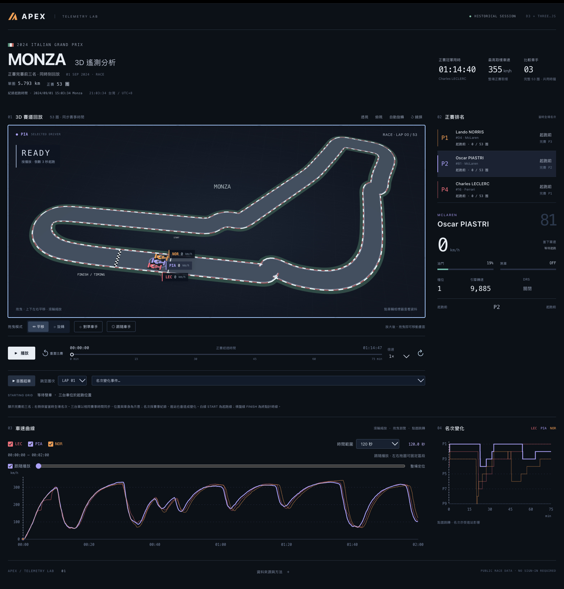
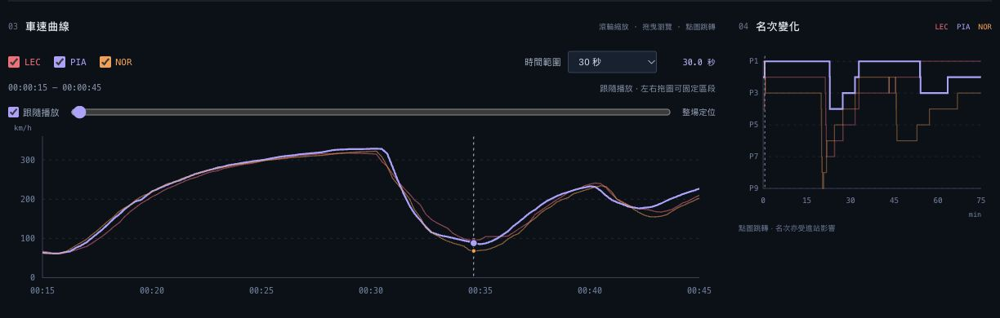

# F1 正賽動態視覺化

APEX Monza 3D 遙測分析

資料分析與視覺化應用 HW2　｜　415085047 嚴庭亞

製作日期 2026 年 10 月 28 日　｜　賽事日期 2024 年 9 月 1 日

[GitHub 專案](https://github.com/victorien1963/1151VIS-HW2-415085047-YEN-TING-YA)

[互動網站](https://victorien1963.github.io/1151VIS-HW2-415085047-YEN-TING-YA/)

YouTube 互動影片：

圖 1　起跑前的完整介面　包含 3D 賽道、車手資料、車速曲線與名次變化

## 資料整理與製作流程

我想把 F1 正賽中的車速、位置與名次變化放在同一個時間基準下觀察，因此選取 2024 年義大利 Monza 站完賽前三名，以 D3.js 製作車速與名次圖，搭配 Three.js 呈現 3D 賽道回放。讀者可以跟隨車手、重播首圈攻防，再放大車速曲線比較細節。

單圈長度為 5.793 公里，正賽共 53 圈。網站免登入，可直接透過 GitHub Pages 開啟；這是歷史賽事資料回放，畫面中的即時數值指目前播放時刻的資料。

### 選定賽事與比較對象

使用 OpenF1 的 2024 Monza 正賽資料，session_key 為 9590。依 FIA 最終成績選取 Charles Leclerc（16）、Oscar Piastri（81）及 Lando Norris（4），三人皆完成 53 圈。選樣依據是完賽前三名，並非三人全程都位於前三名。

Leclerc 為冠軍，用時 1:14:40.727；Piastri 落後 2.664 秒、Norris 落後 6.153 秒。三位車手在視覺化中分別使用粉紅、紫、橘色，讓同屬 McLaren 的兩位車手仍容易區分。

### 整理位置與遙測資料

下載車輛位置、車速、油門、煞車、檔位、引擎轉速及 DRS，並合併圈次、全場名次、差距、進站與賽會紀錄。原始資料留在本機開發專案，發布版的 data/race.json 保存整理後資料及來源查詢網址。

以賽會紀錄 SESSION STARTED 的 2024-09-01T13:03:34.412Z 作為共同 0 秒，即 Monza 15:03:34、台灣 21:03:34。三位車手使用相同賽事時間，沒有把每個人的單圈各自對齊，因此能保留比賽中的先後關係。

### 對齊時間並建立回放

位置及連續遙測整理成每 0.25 秒一筆；煞車、檔位、DRS 等離散狀態採最近取樣。資料處理會檢查取樣缺口，避免跨過大段缺值。名次、圈次及差距使用當時已知紀錄，不提前讀取下一個時間點。

賽道輪廓取自 Leclerc 第 3 圈的位置軌跡，再用 Three.js 建立道路與簡化賽車。播放時按共同時鐘更新三台車的位置及朝向，鏡頭可跟隨選中的車手；車身大小與賽道呈現屬視覺示意。

### 用 D3 建立聯動圖表

D3.js 以資料綁定建立車手列表與曲線，使用 d3.scaleLinear() 對應時間、車速與名次。車速圖用 d3.line()；名次圖用 d3.curveStepAfter，表示名次在紀錄更新後改變，而非平滑地經過小數名次。列表依當時全場名次重新排序。

app.js 管理播放、選取及 D3 圖表；scene.js 負責 Three.js 場景與鏡頭；model.js 負責取樣與時間視窗計算。各區塊共用目前時間及選中車手，讓點選與播放保持一致。

### 驗證並發布網站

檢查共同時鐘、圈次、起跑與完賽名次、插值及時間視窗計算，並在瀏覽器驗證倒數、重置、選車、跟隨、曲線篩選與縮放拖曳。最後將靜態網頁、資料及函式庫一併上傳 GitHub，透過 main 分支的根目錄發布至 GitHub Pages。

## 互動操作與示範

### 播放比賽並跟隨車手

1. 開啟互動網站，車輛停在起跑位置，預設 1× 並開啟「跟隨車手」。按「播放」後，左上角倒數 3 秒才發車；按「重置比賽」回到起跑前，再次播放會重新倒數。

2. 點車輛、車手標籤或右側列表，可切換資料面板與跟隨對象。面板顯示車速、油門、煞車、檔位、轉速、DRS、目前圈數及全場名次。

3. 在「平移」模式拖曳可上下左右移動畫面；切換「旋轉」可改變角度，滾輪可拉近或拉遠。手動平移會解除跟隨；旋轉與縮放保留跟隨。「對準車手」僅在未跟隨時顯示。

4. 按「首圈超車」直接播放 Piastri 超越 Norris 前約 10 秒，並跟隨 Piastri。需要慢看時可選 0.5× 或 0.25×；也可用圈次或名次變化選單定位。

### 放大車速曲線並比較名次

圖 2　15 至 45 秒的車速曲線與整場名次圖　虛線標示目前播放時刻

5. 使用 LEC、PIA、NOR 的 checkbox 各自顯示或隱藏曲線。時間範圍可切換 30、60、120 秒、5 分鐘、10 分鐘或整場；圖 2 選擇 30 秒。

6. 在車速圖內使用滾輪，以滑鼠指向的時間為中心縮放；可視範圍最小 5 秒，旁邊同步顯示目前秒數。左右拖曳圖表或下方定位滑桿可移到其他區段。

7. 拖曳或縮放會切為自由瀏覽，不改變比賽播放時間，也不解除 3D 鏡頭跟隨。勾回「跟隨播放」，車速圖才會重新隨目前時間捲動。

8. 滑鼠移到車速圖可查看時間與各車手數值；名次圖可讀取該時刻排名。點擊任一圖表會暫停並跳至該時間，同步更新車輛與資料面板。

## 圖表觀察與資料限制

### 從首圈回放觀察名次改變

初始排名為 Norris P1、Piastri P2、Leclerc P4。資料約在 26.2 秒記錄 Leclerc 升至 P3，32.3 秒記錄 Piastri 由 P2 升至 P1，41.6 秒再記錄 Leclerc 由 P3 升至 P2。這些時間是名次紀錄的更新點，不等於精確的物理超越瞬間。

圖 1 為起跑前的完整介面，列表顯示 Norris P1、Piastri P2、Leclerc P4，車輛停在起跑位置。圖 2 則放大首圈 15 至 45 秒，可看到三人的車速在約 30 秒後下降，再逐步回升；將名次與速度一起看，有助於選定值得重播的時間段，但單靠曲線不足以判斷超車原因。

### 解讀時需要保留的限制

- 只顯示完賽前三名的車輛與曲線，其他車手仍會影響他們的全場名次；右側不把三人重新編成固定的 1 至 3 名。

- 3D 道路與賽車是位置資料的視覺重建，車身及間距為辨識而調整，不能用來測量精確車距、左右行車線、碰撞或賽道高程。

- 位置與遙測含插值；名次來源採離散更新，可能出現短暫重複排名。圈次起始時間也有近似誤差，官方完賽結果與回放估算時間分別保留。

- 差距缺值、過時或尚未配合新名次更新時顯示「—」，不表示差距為零。名次變化也可能由進站或其他賽事因素造成，不能全部當作賽道超車。

- OpenF1 為非官方資料專案。本站使用預先整理的歷史資料，不是即時賽事直播，也不是賽車物理模擬器。

### 資料來源與技術說明

以下來源分別用於資料欄位、賽道資訊與完賽結果核對。整理後的 JSON 內含本次資料查詢網址；網站頁尾亦可展開「資料來源與方法」。

[OpenF1 API 文件與欄位說明](https://openf1.org/docs/)

[Formula 1 2024 義大利站賽事與賽道資訊](https://www.formula1.com/en/racing/2024/italy)

[FIA 2024 Italian Grand Prix Final Race Classification](https://www.fia.com/sites/default/files/decision-document/2024%20Italian%20Grand%20Prix%20-%20Final%20Race%20Classification%20.pdf)

[本專案整理後正賽資料與查詢來源](https://github.com/victorien1963/1151VIS-HW2-415085047-YEN-TING-YA/blob/main/data/race.json)

D3.js 7.9.0 負責 SVG 圖表、資料綁定與聯動；Three.js 0.180.0、WebGL 及 OrbitControls 負責 3D 場景與鏡頭。因此本作業有使用 D3.js，但不是純 D3.js 實作。函式庫及 ISC／MIT 授權文件保存於 vendor。

本專案使用 AI 協助程式撰寫、除錯與文件整理；資料取自上述來源，截圖擷取自已部署網站。Word 文件與 Markdown 由同一份內容產生。
