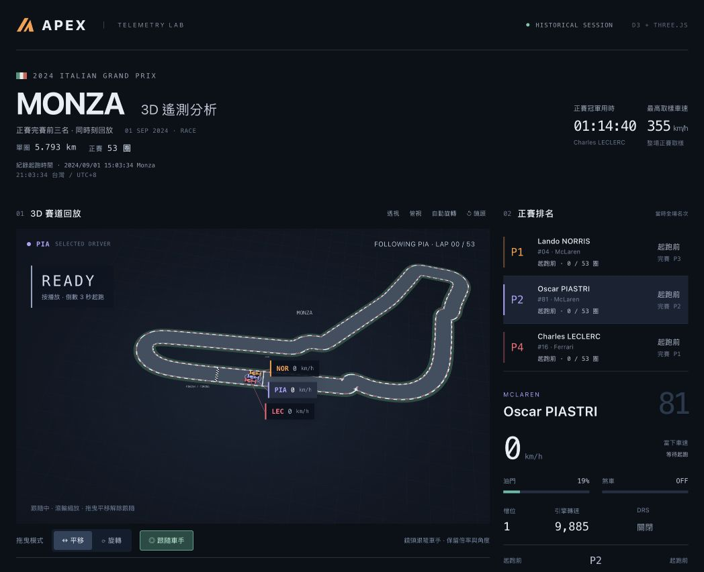

# APEX · F1 正賽 3D 回放

**課程**：1151 資料分析與視覺化應用 HW2  
**學號**：415085047  
**姓名**：嚴庭亞（YEN-TING-YA）

- [互動網站](https://victorien1963.github.io/1151VIS-HW2-415085047-YEN-TING-YA/)
- [GitHub 原始碼](https://github.com/victorien1963/1151VIS-HW2-415085047-YEN-TING-YA)
- [HW2 繳交文件與操作說明](HW2-report.md) · [Word](HW2-415085047-YEN-TING-YA.docx) · [PDF](HW2-415085047-YEN-TING-YA.pdf)
- YouTube 互動影片：待錄製與補上連結。




免登入、可由 GitHub Pages 或本機開啟的 2024 Monza 正賽互動原型。以完整 53 圈的共同賽事時間，回放最終前三名 Leclerc、Piastri、Norris 的位置與遙測；右側顯示各自在當時的全場名次。

## 本機啟動

```sh
python3 -m http.server 4174 --bind 127.0.0.1
```

在儲存庫根目錄執行後開啟 http://127.0.0.1:4174/ 。支援 WebGL 的桌面或手機瀏覽器即可開啟網站；資料及函式庫均已包含，不需要 API 金鑰或登入。

## 操作

- 初次開啟停在起跑位置；按播放後，左上角倒數 3 秒才開始移動。倒數不受播放倍速影響，也不加入資料時間；倒數中可暫停與續播。
- 「重置比賽」回到起跑前並暫停，再按播放會重新倒數。鏡頭跟隨設定保留；「鏡頭」按鈕只恢復視角。
- 預設 1 倍速，可選 0.25、0.5、1、1.25、4、16、32、64 倍速、暫停與循環回放。自然循環也會重新倒數。關閉循環則停在最後一位車手完賽時。
- 三位車手各自顯示當前圈數，初始為起跑前 0 / 53 圈，並可同時位於不同圈次。起跑時名次為 Norris P1、Piastri P2、Leclerc P4；沒有把顯示的三人重新編號為 1–3。
- 「首圈超車」從 Piastri 超越 Norris 的紀錄前 10 秒開始，使用目前選取的倍速播放並跟隨 Piastri。名次變化選單可跳至每個事件前 6 秒；圈次選單以領先車手開始該圈的時間定位。
- 點擊車輛、標籤或車手列表會切換選手，連動資料面板、速度曲線和全場名次圖。列表重排不改變已選車手。
- 速度曲線預設顯示目前附近的 120 秒區間，可切換 30 秒、60 秒、120 秒、5 分鐘、10 分鐘及整場；三位車手可獨立勾選或取消曲線，與鏡頭選取分開。整場模式可直接點圖定位；名次圖顯示整場時間。兩張圖可 hover 查值、點擊跳轉。也可直接拖曳完整正賽時間軸。
- 拖曳模式「平移」可上下左右移動畫面；「旋轉」可旋轉視角。右鍵執行另一種操作；滾輪縮放，觸控單指採目前模式、雙指縮放／平移。
- 預設開啟「跟隨車手」，讓選中的車保持中央，保留倍率與角度；播放、換車、圈次跳轉及重置後仍跟隨。手動平移或恢復全景視角會解除跟隨，旋轉及縮放會保留。
- 「對準車手」只對準一次；開啟跟隨時隱藏此按鈕，停止跟隨後重新顯示。跟隨中不重複移動鏡頭或清算旋轉慣性。3D 圖取得焦點後，可用方向鍵依模式平移或旋轉，加減鍵縮放；空白鍵播放／暫停，Escape 暫停。

## 正賽資料與可解讀範圍

賽道單圈長度 **5.793 公里**，正賽 **53 圈**，依 [Formula 1 官方 2024 義大利站資訊](https://www.formula1.com/en/racing/2024/italy)。

來源：[OpenF1 文件](https://openf1.org/docs/)，session **9590**，2024-09-01 Monza Race。OpenF1 是非官方公開資料專案。選取依據為 [FIA 最終正賽結果](https://www.fia.com/sites/default/files/decision-document/2024%20Italian%20Grand%20Prix%20-%20Final%20Race%20Classification%20.pdf)。

| 完賽名次 | 車手 | 圈數 | 官方總用時 | 與冠軍差距 |
| --- | --- | --- | --- | --- |
| P1 | Charles Leclerc #16 | 53 | 1:14:40.727 | — |
| P2 | Oscar Piastri #81 | 53 | 1:14:43.391 | +2.664 s |
| P3 | Lando Norris #4 | 53 | 1:14:46.880 | +6.153 s |

- **共同時間**：使用 race_control 的 `SESSION STARTED`，`2024-09-01T13:03:34.412Z` 作為 0 秒。相當於 Monza 15:03:34.412（UTC+2）、台灣 21:03:34.412（UTC+8）。所有車手的位置、遙測、名次、圈次使用此共同 UTC 基準，沒有再把每位車手或每圈各自對齊起點。
- **名次**：使用 `position` 最近已知紀錄，階梯式更新；不從 3D 車身位置或單圈距離推估排名。來源更新時間不等於精確的物理交會瞬間，異步更新偶爾可能暫時重複名次。
- **差距**：使用 `intervals` 最近已知值。超過 15 秒、該次名次更新後尚未有新差距或缺值時顯示 `—`；P1 顯示 LEADER，完賽後使用最終結果差距。資料缺值不代表相差零秒。
- **圈數**：每位車手按自己的 `laps.date_start` 更新當前圈；該欄位本身屬近似時間。完賽時間採最後一圈起始時間加圈速，與官方總用時約差 0.5–0.7 秒；官方結果獨立保留。各車完賽後固定在終點取樣，標籤顯示 FIN，當下遙測顯示 `—`。
- **車輛移動**：X/Y 位置和連續遙測以 0.25 秒插值，煞車、檔位、DRS 採最近取樣。原始取樣約 3.7 Hz，此批資料最長位置間隔 1.319 秒、遙測 1.320 秒。重建時會拒絕超過 2 秒的缺口，不默默跨越大段缺測。
- **3D 示意**：賽道由 Leclerc 第 3 圈描繪，車輛使用各自完整正賽取樣，車頭沿軌跡轉向。車身尺寸與橫向間距為辨識而放大；不能還原精確左右行車線、碰撞、真實車距或賽道高程。這是賽事資料回放，不是碰撞物理模擬器。
- **事件**：49 筆所選車手名次變化；僅已確認的首圈 Piastri 超越 Norris、Leclerc 超越 Norris 標示「首圈超車」。其他紀錄稱為「名次變化」；「進站前後」表示距任一車手進站紀錄 60 秒內，只是時間提示，不推論事件成因。OpenF1 overtakes 本身可能包含進站與處罰引發的交換，不能全部視為賽道超車。
- **範圍**：只畫完賽前三名；其他車手仍影響其全場排名，但沒有在賽道上呈現。要觀察首圈三人的攻防可使用專用跳轉按鈕。

## 專案結構與製作流程

- `index.html`、`style.css`：介面與響應式排版。
- `app.js`：D3.js 車速與名次圖、播放狀態、篩選、拖曳與縮放。
- `scene.js`：Three.js 賽道、車輛、點選與跟隨鏡頭。
- `model.js`：取樣插值、真實名次與時間視窗計算。
- `data/race.json`：預先整理的完整正賽資料，內含查詢網址、UTC 基準與來源時間戳。
- `vendor/`：D3.js、Three.js、OrbitControls 與其授權文件。

製作流程：選定 2024 Monza 正賽與完賽前三名 → 取得 OpenF1 位置、遙測、圈次、名次與進站資料 → 以共同 UTC 起點對齊並檢查缺測 → 重建單圈賽道與完整正賽移動 → 使用 D3.js 建立聯動圖表 → 加入播放、鏡頭跟隨、篩選、拖曳及滑鼠中心縮放 → 驗證資料與互動 → 部署 GitHub Pages。

## 技術與驗證

- Three.js 0.180.0：WebGL 3D 車輛、賽道、光照、OrbitControls 和跟隨鏡頭（MIT）。
- D3.js 7.9.0：資料綁定、名次排序、速度曲線、名次階梯圖與點擊聯動（ISC）。
- 函式庫及授權位於 `vendor/`。頁面不需外部 API，也不是純 D3.js。
- 部署前於開發專案執行 JS 語法及 11 組資料／邏輯測試，涵蓋共同 UTC 對齊、53 圈完整性、開賽／超車／完賽名次、不提前讀取未到時刻的名次與圈次、獨立車手圈數、插值、靜止時的車頭方向與單圈道路幾何。

瀏覽器已驗證起跑倒數期間時間保持 0、暫停及續播倒數、正式起跑、重置後重新倒數、首圈 P2→P1 的名次變化、同一時刻各車手不同圈數、圈次跳轉、跟隨時縮放與旋轉、平移解除跟隨，以及完賽停止；未見頁面執行錯誤。


Monza 起跑線與終點計時線分開標示，起跑線位於計時線下游約 309 m；依 FIA 2024 Monza 賽道規格，沿重建賽道用 309/5793 弧長比例示意，並非精確測繪位置。車輛起跑座標保持原始資料。

車速圖可左右拖曳瀏覽；拖動圖表或下方整場定位滑桿會關閉圖表的「跟隨播放」，固定檢視區段，不變更回放時間或 3D 鏡頭跟隨。勾回跟隨播放即回到目前時刻。點圖仍可暫停並跳轉；播放游標在區段外時隱藏。整場範圍不需平移。

車速圖內的滾輪以游標指向時間為錨點縮放（最小 5 秒、最大整場），時間範圍同步顯示秒數及自訂選項。縮放切至自由瀏覽，可接續左右拖曳；播放時間與 3D 跟隨不變。賽事兩端會限制可視區域。圖外保留正常網頁捲動。

## 課程繳交待辦

依 [HW2 作業說明](https://elearn2.fju.edu.tw/course/403380/learning-activity#/3155578)：公開儲存庫命名為 `1151VIS-HW2-學號-姓名`，並提供專案截圖、GitHub 連結、YouTube 影片、製作流程及操作說明，文件內容同步至 Markdown。

- 待錄製互動影片並上傳個人 YouTube，補上連結。
- 待依教師要求共享給 cchu.fju@gmail.com。
- 待整理與繳交正式文件；網站部署不等於已完成課程繳交。
